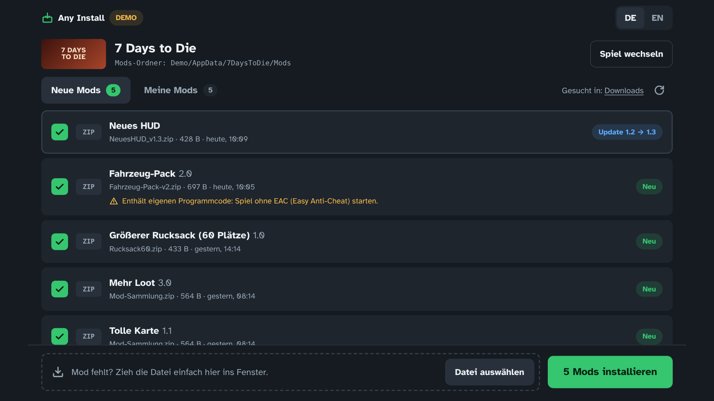
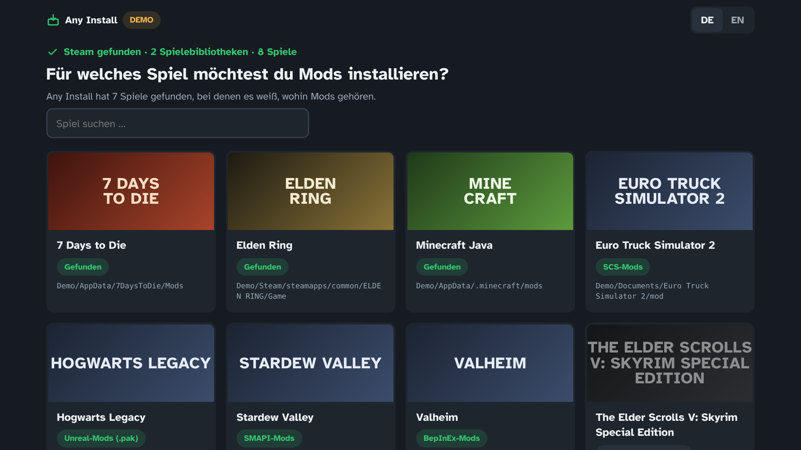
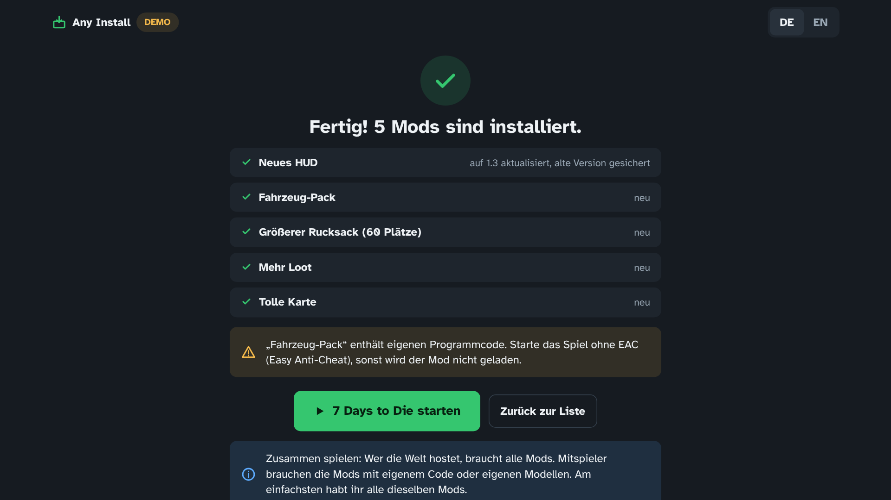
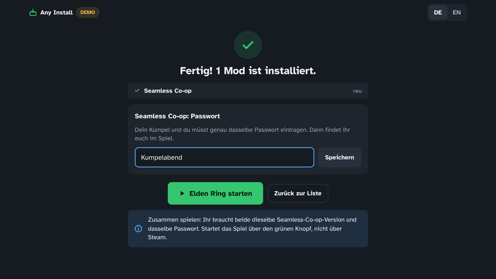
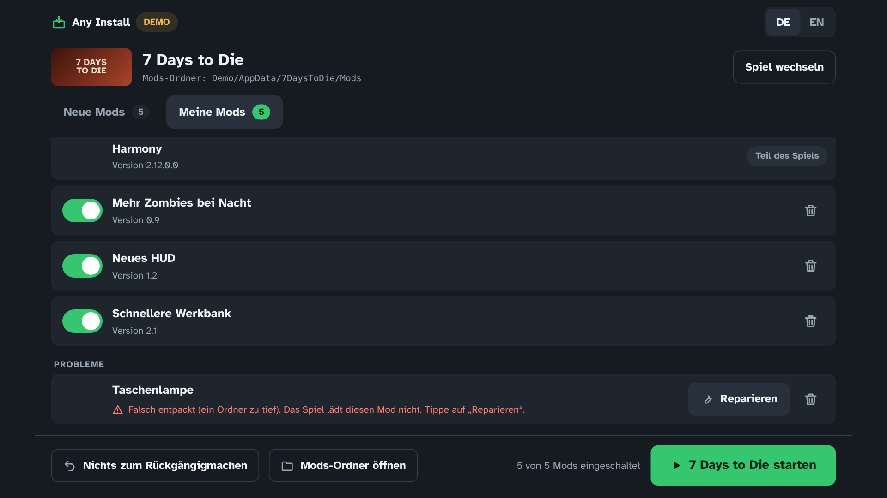

# Any Install

**Mods installieren, ohne sich mit Ordnern herumzuschlagen.** Any Install findet
heruntergeladene Mods im Download-Ordner und packt sie automatisch an die richtige
Stelle im Spiel. Eine einzige Datei, keine Installation, läuft unter Windows und Linux.



| Spiel | Was Any Install kann |
|---|---|
| **7 Days to Die** (Steam) | Mods (Ordner mit `ModInfo.xml`) richtig entpacken, egal wie das Archiv gebaut ist. Updates erkennen, falsch entpackte Mods reparieren, Hinweis bei Mods mit eigenem Code (EAC). |
| **Elden Ring** (Steam) | **Seamless Co-op** installieren und das gemeinsame Passwort setzen, das Passwort bleibt bei Updates erhalten. Dazu der Elden Mod Loader und DLL-Mods. Mods für Mod Engine 2 werden erkannt, aber noch nicht installiert. |
| **Minecraft Java** | `.jar`-Mods, Ressourcenpakete und Shader. Prüft, ob Mod-Loader und Minecraft-Version passen, und richtet **Fabric mit einem Klick** ein. |

## So geht's

1. Mod ganz normal herunterladen, zum Beispiel von Nexus Mods, Modrinth oder CurseForge. **Nicht entpacken.**
2. **Any Install** starten. Beim ersten Mal das Spiel auswählen.
3. Die neuen Mods sind schon angehakt. Auf **„Mods installieren“** klicken, fertig.

Fehlt eine Datei in der Liste, zieh sie einfach ins Fenster oder tippe auf „Datei auswählen“.

| | |
|---|---|
|  |  |
|  |  |

## Herunterladen und starten

Die fertigen Dateien gibt es auf der [Releases-Seite](../../releases).

**Windows (auch ROG Ally):** `AnyInstall.exe` herunterladen und doppelklicken.
Beim ersten Start zeigt Windows eventuell „Der Computer wurde durch Windows geschützt“,
weil die Datei nicht digital signiert ist. Dann auf **„Weitere Informationen“** und
**„Trotzdem ausführen“** klicken. Das kommt nur einmal. Manche Virenscanner sind bei
unsignierten Programmen ebenfalls misstrauisch. Der Quellcode liegt hier offen, und die
Datei wird von GitHub Actions direkt aus diesem Code gebaut.

**Linux:** `AnyInstall-linux-x86_64` herunterladen, ausführbar machen und starten:

```sh
chmod +x AnyInstall-linux-x86_64
./AnyInstall-linux-x86_64
```

Das Fenster ist ein App-Fenster von Microsoft Edge (unter Windows immer vorhanden) bzw.
Chromium/Chrome unter Linux. Ohne diese Browser öffnet sich der Standardbrowser.
Schließt du das Fenster, beendet sich Any Install von selbst.

### Ausprobieren ohne die Spiele

```sh
./AnyInstall-linux-x86_64 --demo     # Windows: AnyInstall.exe --demo
```

Der Demo-Modus baut einen erfundenen Computer mit Steam, allen drei Spielen und einem
Download-Ordner voller Beispiel-Mods in einem Temp-Ordner. An echten Spielen wird dabei nichts verändert.

## Wohin kommen die Mods?

| Spiel | Ziel |
|---|---|
| 7 Days to Die | `%APPDATA%\7DaysToDie\Mods` (Linux: `~/.local/share/7DaysToDie/Mods`). Das ist der Ordner, den das Spiel seit Version 1.0 bevorzugt. Mods im alten `Mods`-Ordner im Spielverzeichnis werden weiter erkannt und dort aktualisiert. |
| Elden Ring | `ELDEN RING\Game` (Seamless Co-op, Mod Loader) und `ELDEN RING\Game\mods` (DLL-Mods) |
| Minecraft Java | `%APPDATA%\.minecraft\mods`, `resourcepacks`, `shaderpacks` (Linux: `~/.minecraft`) |

Steam wird automatisch gefunden, mit allen Spielebibliotheken auf allen Laufwerken.
Ein Spiel in einem ungewöhnlichen Ordner kann man in der Spielauswahl selbst wählen.

## Sicherheit

- **Alles lässt sich rückgängig machen.** Bevor etwas ersetzt oder gelöscht wird, kommt es
  in den Ordner `AnyInstall-Backup` beim Spiel. Die letzten 10 Änderungen pro Spiel werden aufbewahrt.
- **Ausschalten statt löschen:** Ausgeschaltete Mods landen in `Mods_disabled` (bei Minecraft
  bekommen sie die Endung `.disabled`) und sind mit einem Klick wieder da.
- Läuft das Spiel noch, wird nichts verändert.
- Archive mit Pfaden, die aus dem Zielordner ausbrechen wollen, werden nicht entpackt.
  Any Install führt nie Dateien aus den Downloads aus und braucht keine Admin-Rechte.
- Internet ist nur für die Fabric-Einrichtung nötig. Es werden keine Daten gesammelt.

Einstellungen und eine Protokolldatei (`anyinstall.log`, hilfreich bei Problemen) liegen
im Ordner `AnyInstall-Daten` neben der Programmdatei.

## Zusammen spielen

- **Elden Ring:** Beide brauchen dieselbe Seamless-Co-op-Version und dasselbe Passwort.
  Gestartet wird über den grünen Knopf in Any Install (oder `ersc_launcher.exe`), nicht über Steam.
- **Minecraft:** Alle brauchen dieselbe Minecraft-Version und dieselben Mods. Für eine eigene
  Welt übers Internet ohne Server hilft der Mod [e4mc](https://modrinth.com/mod/e4mc).
- **7 Days to Die:** Wer hostet, braucht alle Mods. Mitspieler brauchen die Mods mit eigenem
  Code oder eigenen Modellen. Am einfachsten haben alle dieselben Mods.

## Selbst bauen

Benötigt [Go](https://go.dev) 1.24 oder neuer.

```sh
go test ./...            # Tests
go run . --demo          # starten im Demo-Modus
scripts/build.sh v0.1.0  # Windows- und Linux-Datei nach dist/
```

Bei jedem Push baut GitHub Actions beide Dateien. **Neue Version veröffentlichen:** in der Datei
`VERSION` die Nummer erhöhen (z. B. `v0.2.0`) und nach `main` mergen. GitHub legt dann die
Release-Seite mit `AnyInstall.exe` und der Linux-Datei an.

Aufbau:

- `internal/steam`: Steam, Bibliotheken (`libraryfolders.vdf`) und Spiele (`appmanifest_*.acf`) finden
- `internal/archive`: zip, 7z, rar, jar und Ordner lesen und sicher entpacken
- `internal/games`: was ein Mod pro Spiel ist und wohin er gehört
- `internal/install`: Installieren mit Sicherung, Rückgängig
- `internal/server`, `web/`: lokale Oberfläche (nur über `127.0.0.1` und mit Zufalls-Token erreichbar)
- `docs/PLAN.md`: der ursprüngliche Plan mit Entwürfen

Schrift: [Atkinson Hyperlegible](https://brailleinstitute.org/freefont) (SIL Open Font License, siehe `web/fonts/OFL.txt`).

---

## English

Any Install finds mods in your download folder and installs them in the right place:
7 Days to Die, Elden Ring (Seamless Co-op with password, Elden Mod Loader, DLL mods) and
Minecraft Java (mods, resource packs, shaders, one-click Fabric setup). It is a single
portable file for Windows and Linux with a German and English interface. Everything it
changes is backed up and can be undone. Try it without the games: `AnyInstall --demo`.
