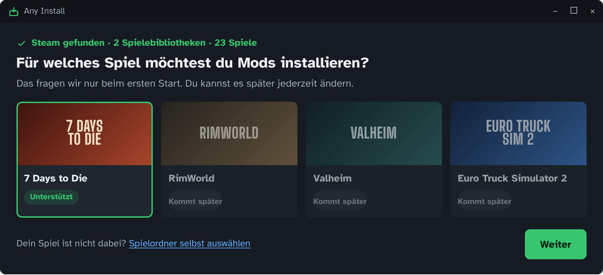
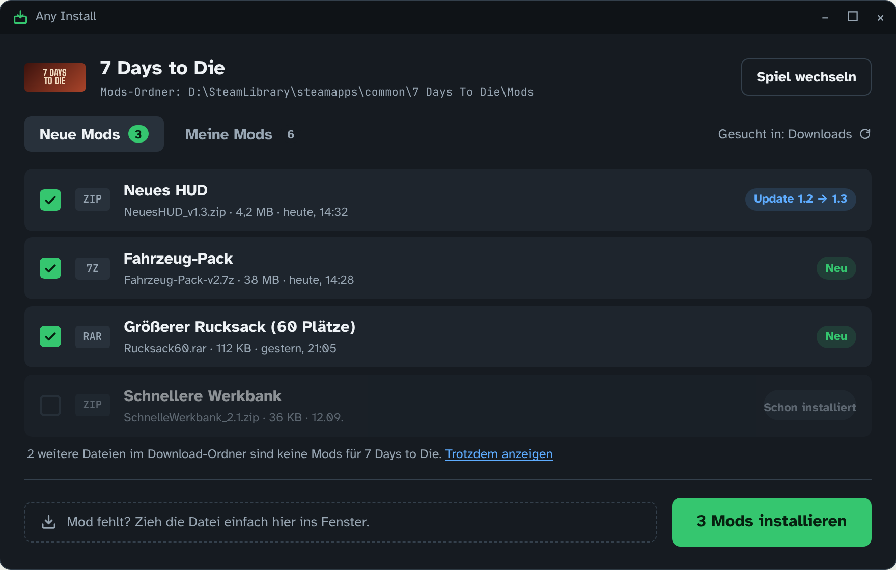
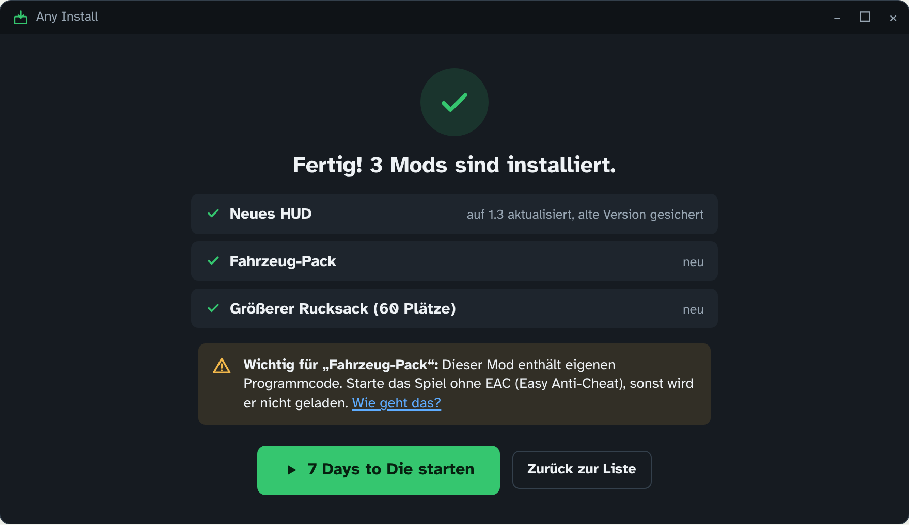
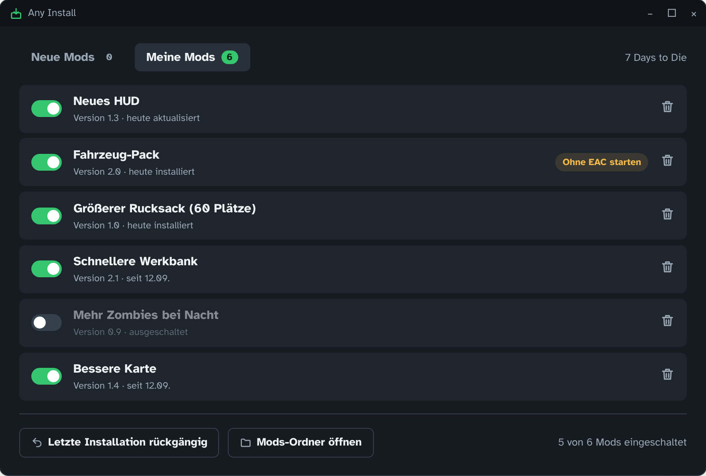
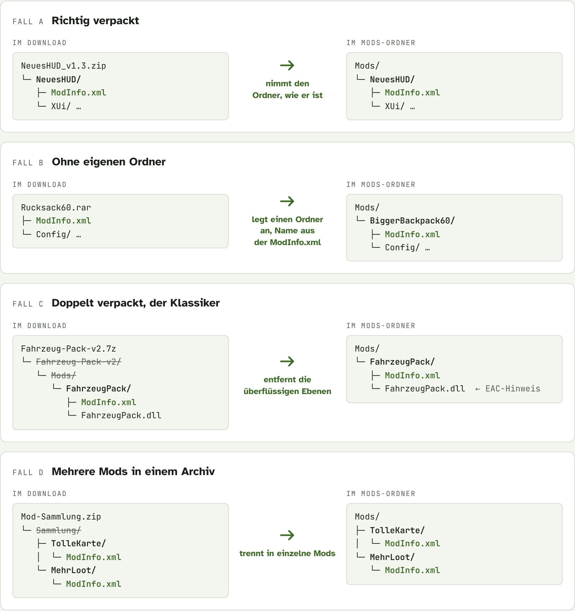

# Any Install – Bauplan (Entwurf 1)

## Stand nach der Abstimmung (13.10.2026)

Antworten auf die offenen Fragen und was daraus folgt:

| Frage | Antwort | Entscheidung |
|---|---|---|
| System des Kumpels | Windows 11 auf dem **ASUS ROG Ally**, getestet wird unter Linux | Touch-taugliche Oberfläche (große Knöpfe, „Datei auswählen“ statt nur Drag & Drop), Fenster passt sich dem 7-Zoll-Bildschirm an. Demo-Modus zum Testen unter Linux ohne die Spiele. |
| Sprache | „Was am besten geht“ | **Go**, aber die Oberfläche läuft als App-Fenster von Microsoft Edge statt mit Fyne. Edge ist auf jedem Windows 11 dabei und kann Touch-Scrollen auf dem Ally von Haus aus. Fyne hat damit unter Windows Probleme. Weitere Vorteile: Die Oberfläche sieht exakt wie die Entwürfe aus, lässt sich automatisch testen, und die `.exe` ist nur ~9 MB groß. |
| Spiele | 7 Days to Die, **Elden Ring**, **Minecraft Java** | Elden Ring: Seamless Co-op samt Passwort, Elden Mod Loader, DLL-Mods. Minecraft: Mods, Ressourcenpakete, Shader, Versionsprüfung und Fabric-Einrichtung. Minecraft ist kein Steam-Spiel; es wird über den `.minecraft`-Ordner gefunden. |
| Eigener Server | Nein, Multiplayer-Welt im Spiel | Kein Server-Ziel. Stattdessen Tipps zum Zusammenspielen nach der Installation (Seamless Co-op, e4mc für Minecraft). |
| Name, Sprache | Umbenennen erlaubt, Deutsch + Englisch | Name bleibt **Any Install** (passt zum Repo). Oberfläche auf Deutsch und Englisch, umschaltbar oben rechts. |

Wichtige Erkenntnis bei der Umsetzung: 7 Days to Die bevorzugt seit Version 1.0 den
Mods-Ordner unter `%APPDATA%\7DaysToDie\Mods`. Neue Mods kommen dorthin, Mods im alten
Ordner im Spielverzeichnis werden weiter erkannt.

Umgesetzt sind Etappe 1 und der größte Teil von Etappe 2 (Meine Mods mit Ein/Aus,
Entfernen, Rückgängig, Reparieren; Drag & Drop; „Spiel läuft“-Prüfung; weitere Suchordner).
Wie es jetzt aussieht, zeigt die [README](../README.md).

**Version 0.2 (14.10.2026): alle Steam-Spiele.** Statt nur fester Spiele erkennt Any Install
jetzt jedes Steam-Spiel mit eindeutigem Mod-System (BepInEx, MelonLoader, Unreal-Paks,
eigener Mods-Ordner) und kennt die Regeln einiger beliebter Spiele. Grundsätze dabei:
nur anbieten, was sicher funktioniert; bei unbekannter Zuordnung nichts vorab anhaken;
Spiele mit Ladereihenfolge oder Anti-Cheat bewusst auslassen. Welcher Download zu welchem
Spiel gehört, entscheidet bei diesen Spielen der Nutzer.

---

Ein kleines Programm, das Mods im Download-Ordner findet und sie richtig in den
Mods-Ordner des Spiels entpackt. Eine einzige Datei, kein Setup, läuft unter
Windows und Linux. Erstes Ziel: **7 Days to Die** über Steam.

**So einfach soll es sein:**

1. **Mod herunterladen** – wie immer, z. B. von Nexus Mods. Nichts entpacken.
2. **Any Install öffnen** – die neuen Mods stehen schon in der Liste und sind angehakt.
3. **„Installieren“ klicken** – fertig. Auf Wunsch startet das Spiel gleich über Steam.

## So sieht es aus (Entwürfe)

Große Schrift, wenige Knöpfe, keine Fachbegriffe. Jeder Bildschirm hat genau
eine Hauptaktion, und die ist grün.

### Bild 1 – Erster Start



Steam und die Spiele werden automatisch gefunden, auch auf zweiten Festplatten.
Die Spielauswahl kommt nur einmal, danach öffnet das Programm direkt die Mod-Liste.

### Bild 2 – Hauptbildschirm



Alles, was nach einem Mod für dieses Spiel aussieht, steht in der Liste, das
Neueste oben. Neue Mods und Updates sind schon angehakt. Was schon installiert
ist, ist abgehakt, und Dateien wie Urlaubsfotos oder Treiber werden ausgeblendet.

### Bild 3 – Nach dem Installieren



Klare Rückmeldung. Ein Hinweis erscheint nur, wenn er nötig ist, etwa bei Mods
mit eigenem Code, die mit Easy Anti-Cheat (EAC) nicht laden.

### Bild 4 – Meine Mods



Mods ein- und ausschalten, ohne sie zu löschen (Ausschalten schiebt den Mod in
einen Parkplatz-Ordner). Jede Installation lässt sich rückgängig machen.

## Die Hauptfunktion: richtig entpacken

Der häufigste Fehler ist der falsche Ordner: eine Ebene zu viel oder zu wenig,
und das Spiel lädt den Mod ohne Fehlermeldung einfach nicht.

> **Regel:** Jeder Ordner, in dem eine `ModInfo.xml` liegt, ist ein Mod. Genau
> dieser Ordner wird nach `Mods/` kopiert, egal wie tief er im Archiv steckt.



Aus der `ModInfo.xml` werden auch Name und Version gelesen (Erkennung von
„schon installiert“ und Updates). Liegen `.dll`-Dateien im Mod, kommt der EAC-Hinweis.

## Was im Hintergrund passiert

1. **Steam finden** – Windows: Registry `HKCU\Software\Valve\Steam`.
   Linux: `~/.local/share/Steam`, `~/.steam/steam`, Flatpak und Snap.
2. **Alle Spielebibliotheken lesen** – `steamapps/libraryfolders.vdf`.
3. **Das Spiel finden** – `appmanifest_251570.acf` → Installationsordner.
   Fehlt `Mods`, wird er angelegt.
4. **Downloads durchsuchen** – echter Download-Ordner vom System (Windows
   Known Folder, Linux XDG). Erkannt werden `.zip`, `.7z`, `.rar` und schon
   entpackte Mod-Ordner. Archive werden nur angeschaut, nicht entpackt.
5. **Installieren** – in einen Zwischenordner entpacken, prüfen, nach `Mods`
   verschieben. Vorhandene Versionen werden vorher gesichert.

## Technik

Vorschlag: **Go** mit der Oberflächen-Bibliothek **Fyne**.

- Eine Datei pro System: `AnyInstall.exe` (Windows), `AnyInstall` (Linux, zusätzlich AppImage).
- Keine Installation, keine Admin-Rechte, läuft vom USB-Stick und auf dem Steam Deck (Desktop-Modus).
- zip, 7z und rar werden direkt im Programm entpackt, ohne 7-Zip oder WinRAR.
- Schrift: Atkinson Hyperlegible (für gute Lesbarkeit entworfen).

| | **Go + Fyne (Vorschlag)** | Python + PyInstaller | Tauri | Electron |
|---|---|---|---|---|
| Eine Datei, ohne Installation | ja | ja | ja, braucht unter Linux WebKitGTK | eher ein Ordner |
| Größe | ca. 20–30 MB | ca. 30–60 MB | ca. 5–15 MB | über 100 MB |
| Startzeit | sofort | 2–5 s | schnell | 1–2 s |
| Fehlalarme von Virenscannern | selten | häufig | selten | selten |
| rar und 7z ohne Zusatzprogramm | ja | rar nur mit unrar | ja | mit Zusatzmodulen |

**Spielprofile:** Jedes Spiel ist ein kleiner Eintrag, neue Spiele brauchen keinen neuen Code.

```json
{
  "appId": 251570,
  "name": "7 Days to Die",
  "modsFolder": "Mods",
  "modMarker": "ModInfo.xml",
  "process": "7DaysToDie",
  "codeHint": "Mod enthält Code: ohne EAC starten"
}
```

**Portabel:** Einstellungen und Sicherungen liegen in `AnyInstall-Daten` neben
der Datei (Ausweichort: Benutzerordner). GitHub Actions baut bei jeder Version
beide Dateien automatisch.

**Windows-Hinweis:** Die Datei ist nicht signiert. Beim ersten Start zeigt
Windows „Der Computer wurde durch Windows geschützt“ → „Weitere Informationen“
→ „Trotzdem ausführen“. Kommt mit Bild in die Anleitung.

## Sicherheit

- Sicherung vor jedem Überschreiben, deshalb funktioniert „Rückgängig“ immer.
- Läuft das Spiel noch, bittet das Programm, es erst zu schließen.
- Schutz vor manipulierten Archiven: keine Datei kann außerhalb des Mods-Ordners landen.
- Führt nie etwas aus, braucht kein Internet und keine Admin-Rechte, sammelt keine Daten.
- Verständliche Fehlermeldungen plus Protokolldatei zum Weiterschicken.

## Umsetzung in Etappen

**Etappe 1 – Erste nutzbare Version (Bild 1–3)**
- Steam, alle Bibliotheken und 7 Days to Die finden
- Downloads durchsuchen, Mods erkennen, richtig entpacken (Fall A–D)
- Installieren mit Sicherung, Updates über die Version erkennen
- EAC-Hinweis und „Spiel starten“-Knopf
- Fertige Dateien für Windows und Linux auf GitHub
- Automatische Tests mit Beispiel-Archiven

**Etappe 2 – Mehr Komfort (Bild 4)**
- „Meine Mods“: ein- und ausschalten, löschen, rückgängig
- Datei ins Fenster ziehen
- Prüfen, ob das Spiel noch läuft
- Weitere Suchordner neben Downloads

**Etappe 3 – Mehr Spiele und Extras**
- Weitere Spiele, z. B. RimWorld, Valheim (BepInEx), Stardew Valley (SMAPI)
- Dedicated Server von 7 Days to Die als Ziel
- Englische Oberfläche
- Modpack teilen: eigene Mod-Auswahl als eine Datei weitergeben

## Offene Fragen

1. Welches System nutzt dein Kumpel: Windows, Linux oder Steam Deck?
2. Passt Go als Sprache, oder lieber Python, um selbst mitzubauen?
3. Welche Spiele außer 7 Days to Die sind euch wichtig?
4. Spielt ihr auf einem eigenen Server?
5. Bleibt es beim Namen „Any Install“? Nur Deutsch oder auch Englisch?

---

*Die Beispielbilder sind Entwürfe. Mod-Namen und Dateien sind ausgedacht, die Spielbilder Platzhalter.*
